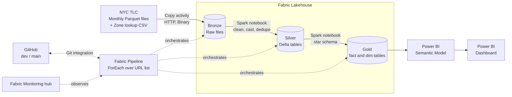
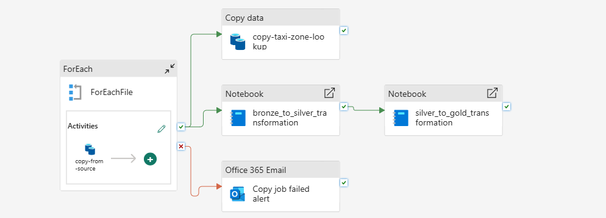
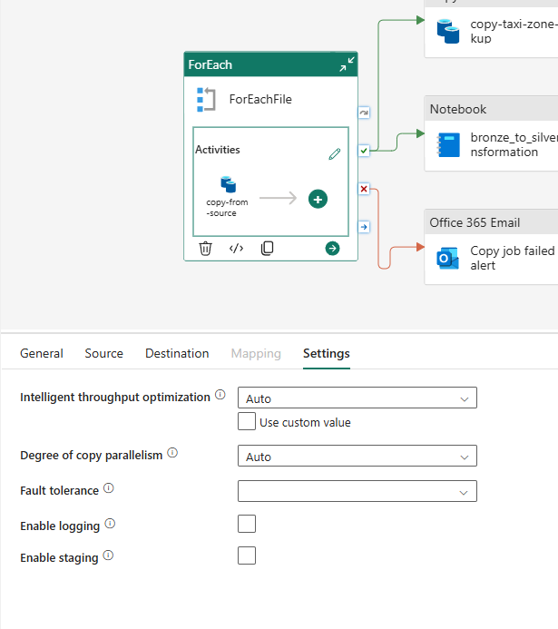
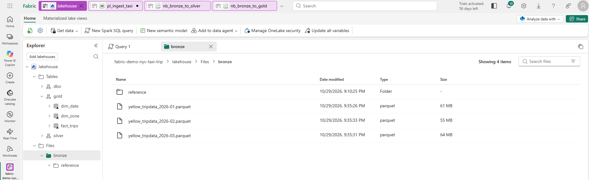
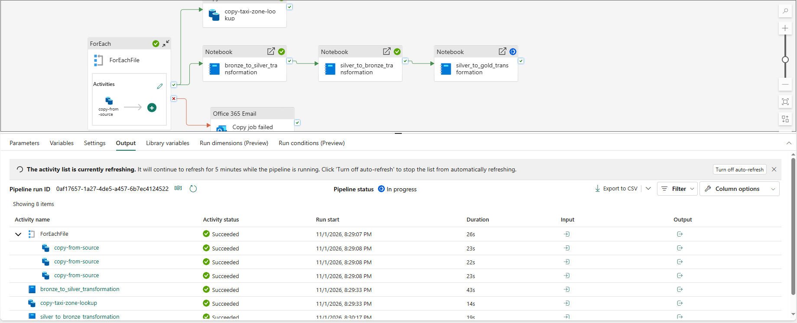
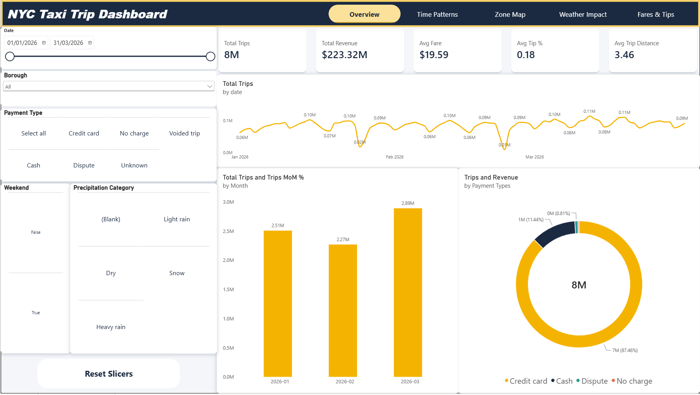
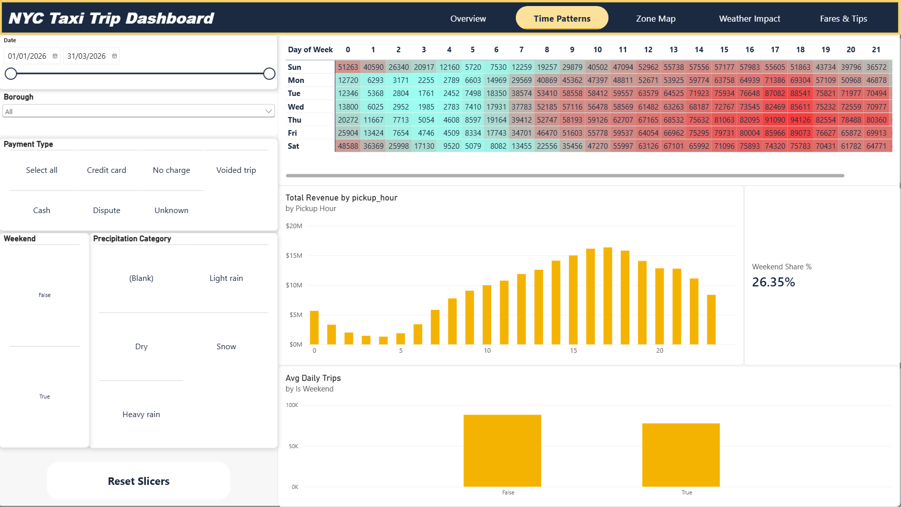
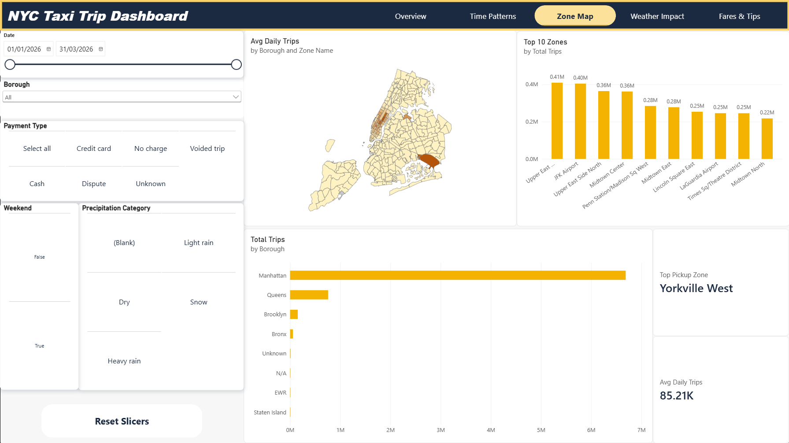
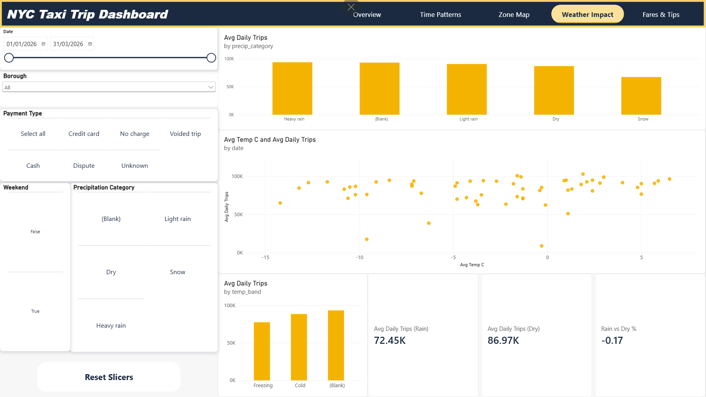
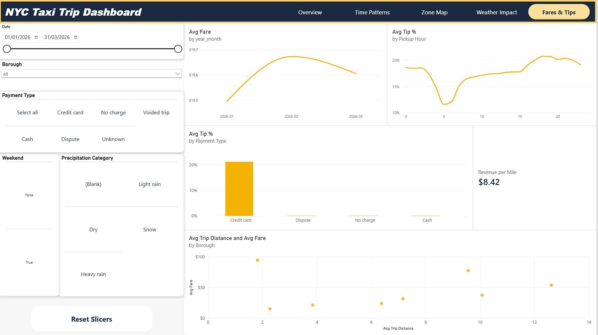

# NYC Taxi Demand & Weather Impact Analytics

An end-to-end analytics project on **Microsoft Fabric** and **Power BI**. It ingests public NYC Yellow Taxi trip data, cleans and models it with a medallion (Bronze / Silver / Gold) architecture, and is version-controlled with GitHub.

The goal is to show a realistic, production-style data engineering workflow: parameterised ingestion, Spark transformations, scheduled orchestration, monitoring, semantic modelling and reporting.

## Project status

| Stage | Status |
|---|---|
| Lakehouse and medallion layout | Done |
| Pipeline: ingest monthly Parquet files from URLs | Done |
| Spark notebooks: Bronze to Silver to Gold | Done |
| GitHub integration (dev branch) | Done |
| Pipeline schedule and monitoring | Planned |
| Weather data ingestion (Open-Meteo) | Planned |
| Power BI semantic model and dashboard | Planned |

## Architecture



### Layers

| Layer | Location | Contents |
|---|---|---|
| Bronze | `Files/bronze/` | Raw, unmodified Parquet and CSV files, copied byte-for-byte |
| Silver | `silver` schema (Delta) | Typed, cleaned and deduplicated trips (`silver.yellow_trips`) |
| Gold | `gold` schema (Delta) | Star schema: `fact_trips`, `dim_date`, `dim_zone` |

## Data sources

| Data | Source | Format | Access |
|---|---|---|---|
| Yellow taxi trip records | [NYC TLC Trip Record Data](https://www.nyc.gov/site/tlc/about/tlc-trip-record-data.page) | Monthly Parquet | Free, no login |
| Taxi zone lookup | NYC TLC (same page) | CSV | Free, no login |
| Daily weather (planned) | Open-Meteo Historical Weather API | JSON | Free, no API key |

## Methdology

### 1. Ingestion (Fabric pipeline)

Pipeline `pl_ingest_taxi` takes an array parameter listing the files to download, for example:

```json
[
  {"file": "yellow_tripdata_2024-01.parquet", "year": "2024"},
  {"file": "yellow_tripdata_2024-02.parquet", "year": "2024"}
]
```

- A **ForEach** activity iterates over the list (`@pipeline().parameters.file_list`).
- Inside the loop, a **Copy** activity uses an **HTTP** connection as the source and the lakehouse **Files** area as the destination.
- Both sides use **Binary** format, so files land in Bronze exactly as published.
- Destination path is built dynamically: `bronze/yellow_taxi/year=<year>/<file>`.
- A separate Copy activity loads the zone lookup CSV into `bronze/reference`.

### 2. Transformation (Spark notebooks)

Both notebooks are parameterised (`start_month`, `end_month`) and called from the pipeline with the Notebook activity.

**Bronze to Silver** (`nb_bronze_to_silver`)
- Standardises column names (for example, `Airport_fee` capitalisation differs between years).
- Casts every column to an explicit type, since TLC types drift between months.
- Removes invalid records: non-positive fares or distances, dropoff before pickup, impossible passenger counts, and pickups outside the requested month range.
- Drops duplicates and derives `trip_minutes` and `tip_pct`.
- Writes Delta tables with `replaceWhere` on the month partition, so reruns are idempotent.

**Silver to Gold** (`nb_silver_to_gold`)
- Builds `dim_zone` from the lookup CSV, `dim_date` from the trip date range, and `fact_trips` partitioned by month.

### 3. Version control

The workspace is connected to the `dev` branch of this repository using Fabric Git integration. Item definitions (pipelines, notebooks, and so on) are committed from the workspace Source control panel. Data itself is not stored in Git; the pipeline rebuilds it.

## Screenshots

### Pipeline canvas


### ForEach and Copy activity configuration


### Lakehouse Bronze folder after a successful run


### Successful pipeline run


### Dashboard Page 1


### Dashboard Page 2


### Dashboard Page 3


### Dashboard Page 4


### Dashboard Page 5


## Repository structure

```
.
├── README.md
├── docs/
│   └── screenshots/
└── fabric/                      # synced by Fabric Git integration
    ├── <lakehouse>.Lakehouse/
    ├── pl_ingest_taxi.DataPipeline/
    ├── nb_bronze_to_silver.Notebook/
    └── nb_silver_to_gold.Notebook/
```

## Lessons learned

1. **The HTTP (Web) activity can't download the data files.** The activity's response object has a 4 MB limit, which is far smaller than a monthly taxi Parquet file. The fix was to use the **Copy activity with an HTTP connector** instead, which streams the file to the lakehouse rather than returning it as an activity output. The Web activity is still fine for small API responses, such as weather JSON.

2. **A Fabric admin must enable Git integration before it can be used.** The relevant tenant permission has to be turned on for users before the GitHub option works in workspace settings. If it's missing, ask the admin rather than debugging the repo.

3. **GitHub integration requires an access token, and fine-grained tokens need the right permissions.** With a fine-grained personal access token, the repository permissions must be granted up to **Read and Write** level. Without write access, Fabric can't create the folder or edit the repository, and connecting or committing fails.

4. **Creating Custom Shape Map in Power BI** For shapre map, add a field to the location field first to get the 'Format Visuals' option.

## Skills demonstrated

Microsoft Fabric (Lakehouse, Data Pipelines, Spark notebooks, Monitoring) · PySpark · Delta Lake · Medallion architecture · Dimensional modelling · Power BI (semantic model, DAX, dashboards) · Git and GitHub workflows

## Acknowledgements

Trip data is published by the [NYC Taxi & Limousine Commission](https://www.nyc.gov/site/tlc/about/tlc-trip-record-data.page). Weather data (planned) is provided by [Open-Meteo](https://open-meteo.com/).
